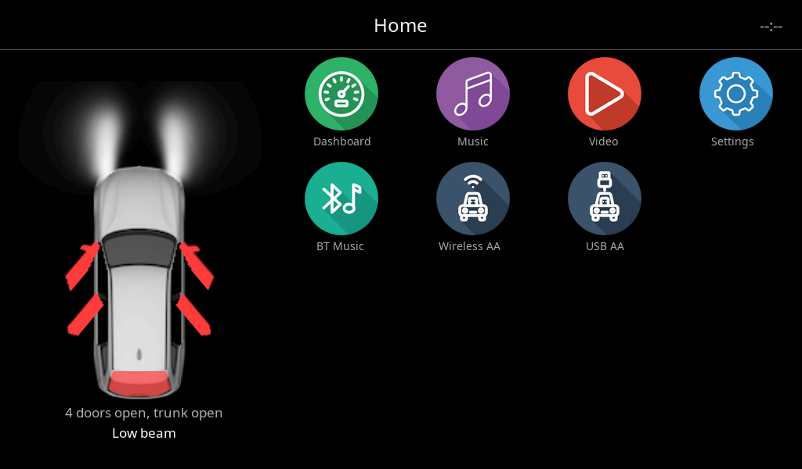
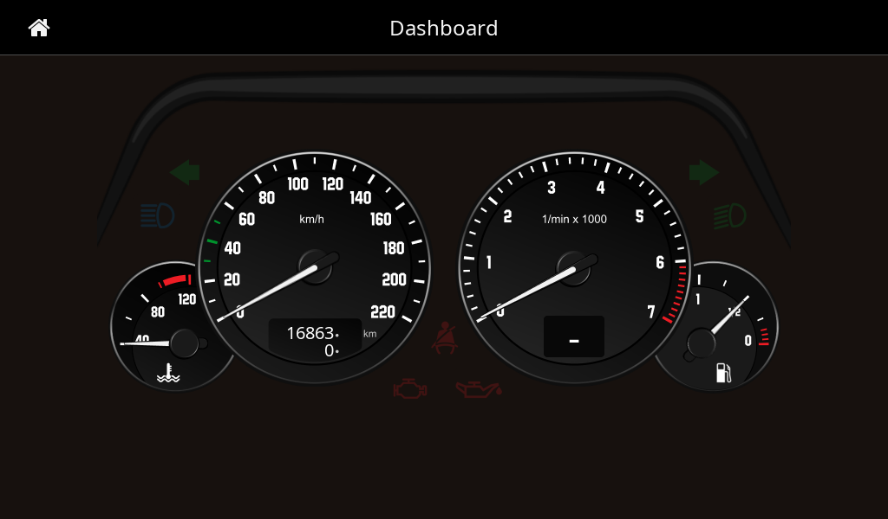
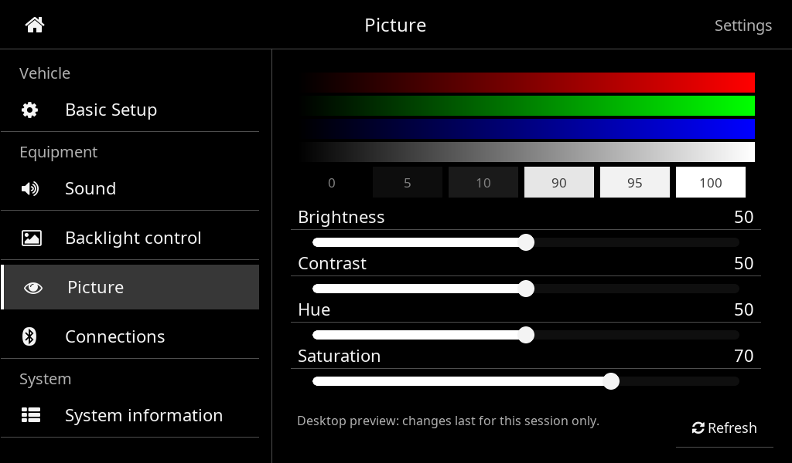

# Linux for the HZ-B500 car head unit

Linux 5.4 (Allwinner Tina SDK) for the HZ-B500, a 1024×600 head unit built on
the Allwinner F133-B (D1s): one T-Head C906 RISC-V core with 64 MiB RAM.

Linux runs from an **SD card**; the stock Melis firmware stays untouched in the
internal flash, so removing the card returns to the original system. The
[Hackaday project](https://hackaday.io/project/205793-reverse-engineering-f133d1s-device)
has hardware details, firmware analysis and how to enter FEL mode.







## What works

| Feature | Status |
| --- | --- |
| Touch UI (HMI) | Home launcher, dashboard, music/video player, settings |
| Android Auto | Wired (USB) and wireless; video, audio, touch, night mode. No microphone |
| Bluetooth music | Phone audio through the AB5301B module, with track info and controls |
| Vehicle data (BMW E90) | Speed, RPM, lights, doors, parking sensors, clock via an added CAN bridge |
| Audio | Speaker and line-out through the AB5301B module |
| Display | Boot logo, backlight dimming with the headlights, picture adjustment |
| Wi-Fi | Access point for wireless Android Auto; station mode untested |
| Optional | DOOM (fbDOOM) on a USB keyboard |
| Not supported | FM transmitter, Linux Bluetooth (BlueZ), camera, MFi chip |

## Hardware

| Component | Connection | Notes |
| --- | --- | --- |
| LCD | 1024×600 RGB, `/dev/fb0` | Backlight PWM7 (PD22), enable PG15 |
| Touch | Goodix GT968, TWI1 (PE0/PE1), `0x5d` | |
| Debug console | UART0, PE2 TX / PE3 RX | 115200 8N1, root shell |
| CAN bridge | J6: UART3, PB6 TX / PB7 RX | Added ESP32 + transceiver, see [vehicle service](package/utils/vehicle/README.md) |
| AB5301B module | UART4, PE4 TX / PE5 RX | Audio routing, Bluetooth; see [AB5301B](package/utils/ab5301b/README.md) |
| SD card | SDC0 | Linux system; tested with a 4 GB SDHC card |
| USB-A | USB0, host mode | Phone (Android Auto), keyboard, storage |
| Wi-Fi | SSV6006 (SV6256P), SDIO | |
| Flash | 16 MiB SPI NOR | Stock Melis, not used by Linux |

There is no battery-backed clock: the first date/time from the car sets the
system time.

## Build and install

Use an x86-64 Linux host. On Debian/Ubuntu:

```bash
sudo apt-get install build-essential binutils git gawk flex bison gettext \
    patch diffutils perl file wget curl rsync unzip zip bzip2 gzip xz-utils \
    cpio tar pkg-config libncurses-dev zlib1g-dev libssl-dev libelf-dev \
    python3 python-is-python3 device-tree-compiler util-linux e2fsprogs \
    dosfstools gcc-riscv64-linux-gnu
```

Install the two SDK compilers as described in [prebuilt/README.md](prebuilt/README.md)
(see [setting up a fresh clone](build/SOURCE_SETUP.md)). Then:

```bash
source build/envsetup.sh
lunch d1s_hz_b500_sd-tina
m -j4          # build everything
p              # pack the SD image
sudo dd if=out/d1s-hz-b500_sd/tina_d1s-hz-b500_sd_uart0.img of=/dev/sdX bs=4M conv=fsync
```

Insert the card and power on; the HMI appears on the LCD. Run `source` and
`lunch` again in every new shell. The [SD profile](target/allwinner/d1s-hz-b500_sd/README.md)
describes the card layout and the boot logo.

## On the device

The UART0 console gives a root shell. Useful commands:

```sh
logread                        # service logs (HMI, audio, vehicle, Android Auto)
ubus call vehicle snapshot     # current vehicle data
ab5301b status                 # audio and Bluetooth state
/etc/init.d/hz-ui restart      # restart the HMI
```

Settings are stored with UCI under `/etc/config/` (`hz-ui`, `ab5301b`,
`vehicle`).

## Desktop preview

The HMI and dashboard also run on the host in an SDL window, with a vehicle
simulator; see the [HMI guide](package/gui/car-dashboards/README.md#desktop-preview).

## Documentation

| Topic | Guide |
| --- | --- |
| Fresh clone, compilers, downloads | [Source setup](build/SOURCE_SETUP.md), [compilers](prebuilt/README.md), [download cache](dl/README.md) |
| SD image and boot logo | [SD profile](target/allwinner/d1s-hz-b500_sd/README.md), [boot logo](device/config/chips/d1s/configs/hz-b500_sd/assets/README.md) |
| HMI | [HMI](package/gui/car-dashboards/README.md) |
| Android Auto | [Android Auto](package/multimedia/android-auto/README.md) |
| Audio and Bluetooth | [AB5301B](package/utils/ab5301b/README.md) |
| Vehicle data and CAN bridge | [Vehicle service](package/utils/vehicle/README.md) |
| DOOM | [fbDOOM](package/games/fbdoom/README.md) |
| Testing a board over UART | [Hardware tests](scripts/HARDWARE_TESTS.md) |

## Licenses

Root [COPYING](COPYING) covers the SDK build system only; every component keeps
its own license. Added third-party components:

| Component | Source URL | License | Location and use |
| --- | --- | --- | --- |
| Android Auto receiver 0.3.8 | [uglyoldbob/android-auto](https://github.com/uglyoldbob/android-auto) | `LGPL-3.0-or-later` | [Receiver](package/multimedia/android-auto/README.md), base `06c68d5ea8ac4f0ef0ab3b97dc60b9665f7074cb`, with local changes |
| `dashboard` (LVGL-CarDashboard) | [zhangwei43721/LVGL-CarDashboard](https://github.com/zhangwei43721/LVGL-CarDashboard) | MIT; [notice](package/gui/car-dashboards/src/dashboard/LICENSE) | [HMI](package/gui/car-dashboards/README.md), base `ae46e17cb7549f272b43e03e635c4a3bc45a49ff` |
| `hmi` (RK3568-LVGL-CarDashboard) | [moli721/RK3568-LVGL-CarDashboard](https://github.com/moli721/RK3568-LVGL-CarDashboard) | MIT; [notice](package/gui/car-dashboards/src/hmi/LICENSE) | [HMI](package/gui/car-dashboards/README.md), base `92a2741d89664f576ca7cbea378084145480a5c5` |
| LVGL 8.3.11 | [lvgl/lvgl](https://github.com/lvgl/lvgl) | MIT; [notice](package/gui/car-dashboards/src/dashboard/lvgl/LICENCE.txt) | Trimmed copy in the HMI; SDK LVGL 8.1.0 in `package/gui/littlevgl-8/` |
| LVGL drivers | [lvgl/lv_drivers](https://github.com/lvgl/lv_drivers) | MIT; [notice](package/gui/car-dashboards/src/dashboard/lv_drivers/LICENSE) | SDL drivers for the desktop preview |
| Patched rustls-webpki 0.103.9 | [uglyoldbob/webpki](https://github.com/uglyoldbob/webpki) | ISC; [notice](package/multimedia/android-auto/notices/webpki-ISC.txt) | Android Auto dependency, locked to `94030fb9fbebf9a2fe53167d53624f4f2a6dd704` |
| TJpgDec | [ChaN's TJpgDec](https://elm-chan.org/fsw/tjpgd/00index.html) | ChaN's permissive notice | JPEG decoder in the HMI's LVGL copy |
| fbDOOM (optional) | [maximevince/fbDOOM](https://github.com/maximevince/fbDOOM) | `GPL-2.0-or-later` | [fbDOOM](package/games/fbdoom/README.md), built from a local checkout |
| Noto Sans Regular | [noto-fonts](https://github.com/notofonts/noto-fonts) | `OFL-1.1` | [HMI fonts](package/gui/car-dashboards/fonts/README.md) |
| Font Awesome 4.7 | [Font-Awesome](https://github.com/FortAwesome/Font-Awesome/tree/v4.7.0) | `OFL-1.1` | HMI icons |

Reused SDK and host components:

| Component | Source URL | License | Use |
| --- | --- | --- | --- |
| Linux 5.4.61 | [Linux stable](https://git.kernel.org/pub/scm/linux/kernel/git/stable/linux.git/) | GPL-2.0 with syscall note; [notice](lichee/linux-5.4/COPYING) | Allwinner kernel with HZ-B500 changes |
| OpenSBI | [riscv-software-src/opensbi](https://github.com/riscv-software-src/opensbi) | `BSD-2-Clause`; [notice](lichee/brandy-2.0/opensbi/COPYING.BSD) | Firmware with direct Linux boot and boot logo |
| SSV6x5x Wi-Fi driver | iComm-semi `L.SMAC.19Q3.0000.00` | ISC-style and GPL files | `lichee/linux-5.4/drivers/net/wireless/ssv6x5x/` |
| CedarX/CedarC | Allwinner Tina, [vendor manifest](build/vendor-manifest.xml) | Mixed vendor terms, binary codecs | Video decoding (HMI, Android Auto) |
| ALSA library | [alsa-lib](https://github.com/alsa-project/alsa-lib) | `LGPL-2.1` | Android Auto audio |
| mpg123 1.33.7 | [mpg123](https://www.mpg123.de/download.shtml) | `LGPL-2.1` | HMI music player |
| FreeType | [FreeType](https://gitlab.freedesktop.org/freetype/freetype) | `FTL` or GPL-2.0 | Font rendering |
| Fontconfig | [Fontconfig](https://gitlab.freedesktop.org/fontconfig/fontconfig) | MIT-style | Desktop preview fonts |
| SDL2 | [SDL](https://github.com/libsdl-org/SDL/tree/SDL2) | zlib | Desktop preview |
| ubus, libubox, json-c | [ubus](https://git.openwrt.org/project/ubus.git), [libubox](https://git.openwrt.org/project/libubox.git), [json-c](https://github.com/json-c/json-c) | LGPL-2.1, ISC, MIT | Vehicle data bus |
| libjpeg, libpng, zlib | [IJG](http://www.ijg.org/), [libpng](http://www.libpng.org/pub/png/libpng.html), [zlib](https://zlib.net/) | IJG, libpng, zlib | Boot logo converter |

The AB5301B controller, vehicle service and boot-logo tool are project code
under `GPL-2.0-only`. Artwork provenance is in the
[HMI assets](package/gui/car-dashboards/assets/README.md) and
[boot logo](device/config/chips/d1s/configs/hz-b500_sd/assets/README.md) notes.
